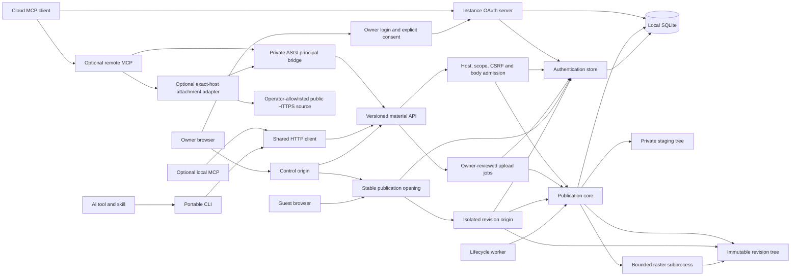
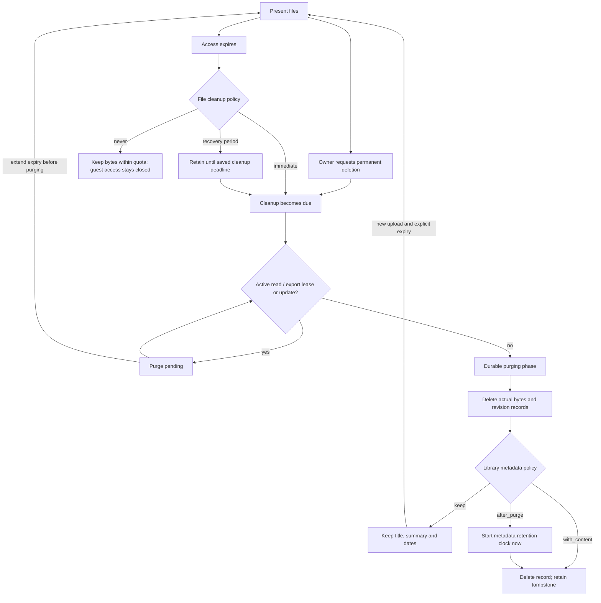

# Minder Publish architecture

This describes the implemented package under [`src/minder_publish/`](../src/minder_publish/).
Building or testing the package does not change an existing deployment.

Minder Publish has one owner per instance, local account/session authentication,
scoped device credentials, optional instance-local OAuth and a local data volume.
The API wire contract belongs to [API.md](implementation/API.md), and
configuration values belong to [the packaged defaults](../src/minder_publish/defaults.json).

## Components and ownership



The control hostname serves the cabinet, `/api/v1`, stable `/p/{link_name}` entries,
`/healthz` and authenticated `/metrics`. Each revision is served at
`r-{revision_id}.{control_hostname}`. The content DNS suffix equals the control
hostname. This keeps the browser opening on one site
while retaining distinct origins and host-only cookies. The packaged
`link-preview.png` and `web/mark.svg` are exports of the
[Open Corner SVG](brand/open-corner.svg). Preview delivery uses packaged files.
Local browser development uses the `publish.localhost` hostname.

| Module | Responsibility |
|---|---|
| [`app.py`](../src/minder_publish/server/app.py), [`http.py`](../src/minder_publish/server/http.py) | Routes, success/problem envelopes, request IDs, host/scope/CSRF admission, bounded bodies and redacted request logging |
| [`auth.py`](../src/minder_publish/server/auth.py) | Owner password/session, device scopes, viewer unlocks and nonce-bound one-time handoffs |
| [`password_vault.py`](../src/minder_publish/server/password_vault.py) | Durable, publication-bound password copies for explicit owner delivery; independent key lifecycle |
| [`navigation.py`](../src/minder_publish/server/navigation.py) | Sealed, cookie-bound one-use continuations from native forms to validated content or OAuth destinations |
| [`oauth/`](../src/minder_publish/server/oauth/) | Optional instance-local authorization server, explicit owner consent, PKCE code flow, resource-bound tokens and revocable app families |
| [`upload_jobs.py`](../src/minder_publish/server/upload_jobs.py) | Nonsecret chat-to-browser requests, creator/session binding and transactional final-commit guards |
| [`distribution.py`](../src/minder_publish/server/distribution.py) | Credential-free instance-specific setup prompts and bounded known code/skill/plugin downloads |
| [`core.py`](../src/minder_publish/server/core.py), [`repository.py`](../src/minder_publish/server/repository.py) | Publication policy, upload reservations, transactional state, revisions and leases |
| [`history.py`](../src/minder_publish/server/history.py) | Bounded revision ledger, retained previous files, explicit revision sharing and owner-only CAS restoration |
| [`statistics.py`](../src/minder_publish/server/statistics.py) | Owner-only lifetime and UTC daily guest/owner opening aggregates |
| [`storage.py`](../src/minder_publish/server/storage.py) | Path/archive validation, bounded copying, manifests and same-filesystem promotion |
| [`previews.py`](../src/minder_publish/server/previews.py) | Credential-free link cards from the same guest lifecycle predicate, with public brand assets |
| [`content.py`](../src/minder_publish/server/content.py), [`exports.py`](../src/minder_publish/server/exports.py) | Authorized content/Range/thumbnail/original serving and streaming site ZIP exports |
| [`lifecycle.py`](../src/minder_publish/server/lifecycle.py) | Idempotent cleanup, stale-phase recovery, retired revisions and tombstones |
| [`thumbnails.py`](../src/minder_publish/server/thumbnails.py) | Raster-only preview generation with resource caps; no HTML rendering |
| [`backup.py`](../src/minder_publish/server/backup.py), [`migration.py`](../src/minder_publish/server/migration.py), [`commands.py`](../src/minder_publish/server/commands.py) | Explicit local bootstrap, maintenance, consistent backup, empty-target restore and read-only legacy import |
| [`static.py`](../src/minder_publish/server/static.py) | Release-bound UI assets, digest-based browser revalidation and precomputed compression |
| [`web/`](../src/minder_publish/server/web/) | Packaged cabinet, local fonts, theme/language preferences and one EN/RU/ES/FR message catalog |
| [`client/`](../src/minder_publish/client/), [`mcp/`](../src/minder_publish/mcp/) | Portable preflight/streaming client, CLI and separate local/remote tool surfaces |
| [`mcp/host_files.py`](../src/minder_publish/mcp/host_files.py) | Optional exact-host, DNS-pinned HTTPS attachment transfer directly into reserved uploads |

Core, authentication, OAuth and upload jobs own separately versioned schemas in the same SQLite
file. Public API serializers select allowed fields; password hashes and internal
snapshots are not API material. The core has no FastAPI dependency. Settings are
persisted per instance; publication/upload planning takes the effective snapshot.

The filesystem contains private upload staging, prepared content and immutable
revision directories. SQLite owns current pointers, per-file manifest metadata,
phase/reservation records and deletion state. Staging and revisions must share a
filesystem. The server holds an instance lock and runs one application worker;
SQLite transactions arbitrate writes and phase ownership.

The `publication_link` table owns the public name namespace, with one primary name
per publication and any deliberately retained addresses. It keeps reservations
after a name is disabled or its publication is removed. Revisions, grants and
statistics refer to the unchanged publication ID. The owner rename transaction
changes the primary and retires or retains the replaced name atomically. Each
ordinary address carries its own messenger preview mode. Revision metadata
owns the mode for pinned addresses. See [Preview controls](LINK_PREVIEWS.md#preview-controls).

## Agents, OAuth and browser-upload requests

The portable CLI and local MCP use a scoped device credential with the external
versioned API. Remote MCP supports those credentials and optional OAuth access tokens
for exactly `<control-origin>/mcp`. Its instance-local authorization server uses the
maintained MCP SDK's public protocol handlers/provider and stores durable grants in
SQLite. Owner login plus explicit recent-authenticated consent grants only material
read/manage scopes. Registration does not fetch external metadata. Codes are one-use;
refresh rotates within a stable grant family with replay revocation. The wire endpoints
and limits belong to [API.md](implementation/API.md#remote-mcp-authorization).

OAuth bearer tokens cannot authenticate an external REST API request. MCP synchronous
tools reuse the shared client with
[`InternalApiTransport`](../src/minder_publish/mcp/internal_api.py): it calls the same
ASGI application in process, carrying a private principal resolver in the ASGI scope.
Admission calls that resolver again for every operation and permits only a device or
OAuth principal, never owner authority. HTTP headers cannot construct this scope entry.
The operation's ordinary validation, scope and quota guards remain in the API/Core.
An exact-route ASGI adapter dispatches control MCP requests without mounting over the
revision's author directory namespace; the transport paths belong to the API contract.
The MCP server specializes the SDK's public tool-call boundary to redact rejected
argument values from validation errors, without private registry hooks or duplicating
the input schemas.

```mermaid
sequenceDiagram
    participant Chat as Connected MCP app
    participant M as Remote MCP / scoped API bridge
    participant J as Upload jobs / SQLite
    participant B as Owner browser
    participant C as Publication core
    Chat->>M: Create file-upload request (kind and nonsecret intent)
    M->>J: Validate live manage-scoped creator; save bounded job
    J-->>Chat: Job ID and owner upload URL
    B->>J: Sign in and open job
    B->>C: Choose local bytes; claim job with normal reservation
    B->>C: Stream, inspect and review
    B->>C: Explicit commit
    C->>J: In transaction: recheck owner, creator, deadline and binding
    C->>C: Promote immutable revision
    Chat->>J: Read own job status
    J-->>Chat: Published state and authoritative stable URL
```

The browser job is the file-delivery path when a cloud host cannot supply attachment
bytes. A job URL is not authority. Its creator cannot choose an owner password, bypass
review or read another creator's jobs. Claiming it reserves ordinary upload resources;
creating a request does not allocate file bytes. Lifecycle cleanup closes expired,
revoked and cancelled jobs and aborts associated work. Already published material
remains independent of its completed request.

When an operator explicitly configures exact attachment-source hosts, remote MCP also
advertises a structured host-file input. The adapter validates the URL and all DNS
answers, pins the selected public address with original-host TLS, and streams a bounded
uncompressed response directly into the same scoped upload API. It creates no separate
download spool and follows no redirects. Prepared manifest/sensitive-name validation
precedes commit. This path does not require a browser file choice; the requesting app
already has material-management authority. It does not infer attachment provenance
from `file_id`, and unknown commit outcomes are reported without automatic retry.
The empty operator allowlist exposes no such tool. Actual provider file-input support
is an integration gate; browser-upload jobs remain the delivery path when unavailable.

Local MCP alone exposes local filesystem publication tools. Public distribution assets
provide the instance's client/skill/plugin setup without secrets. Downloading an archive
does not perform host installation or cloud OAuth consent. The operator-supplied client
wheel must match the running release; its installer verifies SHA-256 and uses a per-user
virtual environment.

## Publication and replacement

```mermaid
sequenceDiagram
    participant C as Browser or CLI
    participant H as HTTP admission
    participant D as Core / SQLite
    participant F as Staging / revision volume
    C->>H: POST /api/v1/uploads (metadata, kind, size)
    H->>H: Authenticate, scope and CSRF checks
    H->>D: Validate plan and reserve peak allocation
    D-->>C: Upload ID, byte bound and deadline
    C->>H: PUT /uploads/{id}/content (raw bytes)
    H->>D: Match subject and active phase
    D->>F: Bounded stream, size check, fsync
    D-->>C: Uploaded phase
    C->>H: POST /uploads/{id}/inspect
    H->>D: Claim bounded preparation phase
    D->>F: Validate file or explicit site ZIP; prepare manifest
    D-->>C: Private prepared manifest and static dependency report
    C->>C: Review report and confirm, or abort
    C->>H: POST /uploads/{id}/commit
    D->>D: Recheck subject, deadline, revision CAS and metadata
    D->>F: Promote complete prepared revision
    D->>D: Commit current pointer; retire old revision; release reservation
    D-->>C: Publication and authoritative stable_url
```

A ZIP is extracted only when `kind=site`; ordinary ZIP files remain unchanged.
Preparation rejects unsafe paths, links, collisions, unsupported archives and
size/file-count excesses before publication. It does not run a build or fetch a URL.
A bounded copy computes file hashes and writes the manifest outside the serving tree.
The optional inspect phase persists prepared state with a review deadline and its
reservation. A shared bounded HTML/CSS scanner reports origins and missing asset
names without executing code. It never claims to account for dynamic JavaScript.
Direct commit remains compatible by preparing first when inspection was omitted.

A replacement carries `publication_id` and `expected_revision`. A concurrent revision
or metadata change causes a conflict instead of silently overwriting it. The current
pointer changes after a complete revision is ready. Failed preparation or CAS leaves
the previous publication available. Crash recovery reclaims expired upload phases
and unreferenced allocations. Upload cancellation retains its reservation while a
receiving/preparing phase still owns bytes; it releases that reservation on exit.

Publication clients share one commit boundary. A definitive structured refusal may
abort pending work, while a transport/5xx/invalid response preserves an unknown outcome
without automatic deletion or republication. An authenticated subject-bound upload
status exposes only phase/deadline and, after commit, historical publication identity.
It does not describe current availability or prove failure when a record is absent.
The browser reconciles this status and can explicitly resume the same prepared ID;
CLI/MCP expose the same operation status for recovery.

Ordinary guest openings select the current revision. Existing reader grants have
bounded drain windows after replacement. Explicit shared-version links select their
pinned revision and never substitute the current version when unavailable.
Owner-only history grants are separate and revalidate the session, material
policy and retained revision on every request. Previewing a historical revision does
not change the stable link. Restoration creates a new revision through reserved
copying and the normal commit CAS, with recent owner authentication. Retention,
budgets and ledger semantics belong to [revision history](REVISION_HISTORY.md).

## Browser handoff and content requests

Native password forms first complete the control-origin
[POST/Redirect/GET continuation](implementation/API.md#native-form-continuation).
The continuation does not grant content access. The diagram shows the full cold
handoff, which checks current policy and subject authority. Ordinary stable-link
GETs enter this flow directly; a browser with an already matching reader grant can
use the validated reuse path described in the
[browser content boundary](implementation/API.md#browser-content-boundary).

```mermaid
sequenceDiagram
    participant B as Browser
    participant C as Control origin
    participant A as Auth / policy stores
    participant R as Revision origin
    B->>C: GET /p/{link_name}
    C->>A: Owner session, link access or guest password unlock
    C->>A: Create short-lived intent bound to current policy/revision
    C-->>B: Redirect to revision /__mp/start?intent
    B->>R: Start intent
    R-->>B: Host-only nonce cookie; redirect to control with nonce hash
    B->>C: /__mp/authorize
    C->>A: Recheck subject, current revision and access version
    A->>A: Consume intent; create nonce-bound one-time code
    C-->>B: Redirect to revision /__mp/accept?code
    B->>R: Code plus browser nonce cookie
    R->>A: Validate nonce, consume code and recheck policy
    R-->>B: Host-only reader cookie; redirect to clean content path
    B->>R: GET / HEAD / Range / conditional request
    R->>A: Revalidate reader, subject and publication policy
    R-->>B: Authorized bytes or denial
```

Owner cookies stay on the control host; content hosts expose no management API.
Device tokens authorize API operations and are not browser owner grants. Viewer
password unlocks are publication-specific and tied to its access version. Logged-in
owner convenience is a server-side choice, not a query flag or browser-local role.

Content policy allows the configured static-site execution/network profile on the
revision origin. Cabinet preview uses a sandboxed iframe; author HTML is never
inserted into the control document. Service Worker script requests are rejected;
ordinary worker/cache behavior still has browser-specific release tests. Resource
caps and Python-level networking denial in the raster worker are not an OS network
sandbox. No headless browser or HTML execution is used for thumbnails.

`LeasedFile` holds a bounded read lease through the whole ASGI response, including
Range/error/cancellation cleanup. A site download streams a ZIP from the stored
manifest through a bounded buffer; it does not spool a second archive to disk.
Authorization precedes every new response, including 304 responses. Expiry and
revocation cannot retract delivered bytes, reliably interrupt a transfer that began
while authorized, or erase recipient copies.

## Packaged interface resources

The control origin serves release-owned files through `static.py`. These public
resources use private browser caching with revalidation on every reuse; digest-based
ETags distinguish content and encoding. Gzip representations are prepared at startup,
while Range requests use identity bytes. Packaged files are immutable for a running
release: changing them requires restarting the application. API responses and
published material remain outside this cache policy; see
[security](SECURITY.md#interface-resources-and-caching).

## Owner workspace and opening statistics

A normal owner document navigation renders the workspace directly at `/p/{link_name}` on
the control origin. Deep paths and author query-driven site navigation keep their ordinary
content route. The trusted shell has a thin rail and side drawer; the document fills
an isolated iframe without injected HTML. Language/theme preferences affect only
control UI. The allowlisted `mp_owner_view` cookie remembers whether ordinary owner
links show this shell; `?preview=tools` explicitly opens it. The compatibility
`/viewer/{id}` route redirects to that control entry. Guest documents open natively
on the isolated revision origin after access checks; the ordinary copy action
always returns the stable material link, independent of the execution address.

The shell loads its message catalog and session concurrently, then fetches owner
settings, material metadata and history in parallel. It retains the document iframe
when its selected revision, source and access/rendering policy are unchanged, so
control-only updates preserve document state. Revision or policy changes create a
new frame. Library requests are paginated; a new search cancels obsolete requests,
with response-generation checks preventing stale results from replacing the list.

The clean-view action opens the original in a separate tab while retaining owner
access. Guest access checks use the separate probe realm. Neither is counted as a
guest opening. Preview sandboxing permits scripts, forms, downloads and new windows
on the revision origin, but not top navigation of the trusted shell. Sites requiring
a full browser context can use the original-tab action. No cross-origin message
bridge exposes owner APIs, credentials or iframe navigation to author scripts.

Statistics are committed with consumption of an eligible one-use opening handoff.
The `statistics.py` module owns separate guest and authenticated-owner lifetime
and bounded UTC daily aggregates in SQLite. The trusted shell itself does not
count; its accepted document iframe handoff records one owner opening. Owner
previews, retained-history openings and clean-view openings use that same path.
Its owner-only read/reset endpoints feed the library and drawer; resetting requires
recent authentication. Cabinet responses add `guest_open_count` and `owner_open_count` independently of
compatibility `view_count`. Collection settings are independent for each audience.
Schema 4 adds owner aggregate tables and a collection-start boundary; it preserves
guest and legacy totals. Its guarded offline schema-3 downgrade retains the additive
owner tables and marks a possible owner-collection gap. The exact counting rules, exclusions, data minimization
and retention belong to [opening statistics](STATISTICS.md). Backup includes the
aggregate tables; publication-record deletion cascades to them.

## Lifecycle: independent axes

Access consists of `private|link|password`, a manual pause, expiry and revocable
subject grants. Content and library metadata have their own states and deadlines:



Manual deletion closes access immediately and bypasses retention to request actual
cleanup; it is not undone by extension. A pending result does not mean files are
already gone. The worker claims the purging phase
before touching files, waits for active leases/uploads and retries incomplete work.
It records metadata retention from actual purge completion. Tombstones prevent a
new upload/import from silently reusing a deleted identity.

Pausing does not reset expiry or cleanup. Extending an unpurged publication does
not remove its manual pause. Publication defaults affect future publications;
existing publication policies are snapshots. Reducing the overall content quota
blocks admission as necessary; lowering history retention or its budget can remove
previous versions through the history policy, never current files.

## Operations and verification boundaries

Backups require stopped writers and contain a consistent SQLite snapshot plus the
referenced immutable revisions and the separate publication-password key. Restore
targets an empty data volume, verifies paths,
manifest hashes and sidecars, rotates the instance secret and revokes restored
credentials. Restore flushes staged files and the recovery marker before installation.
It removes the marker after synchronizing the installed entries. Use a current
tombstone ledger to apply deletions made after the backup.
Legacy import reads a consistent source copy, preserves identifiers, password hashes,
access semantics and counters, and keeps retained legacy bytes without automatic
purge until the owner changes their policy.

Use [self-hosting](SELF_HOSTING.md) for deployment and
[security acceptance](SECURITY.md#release-acceptance) to verify the release.
